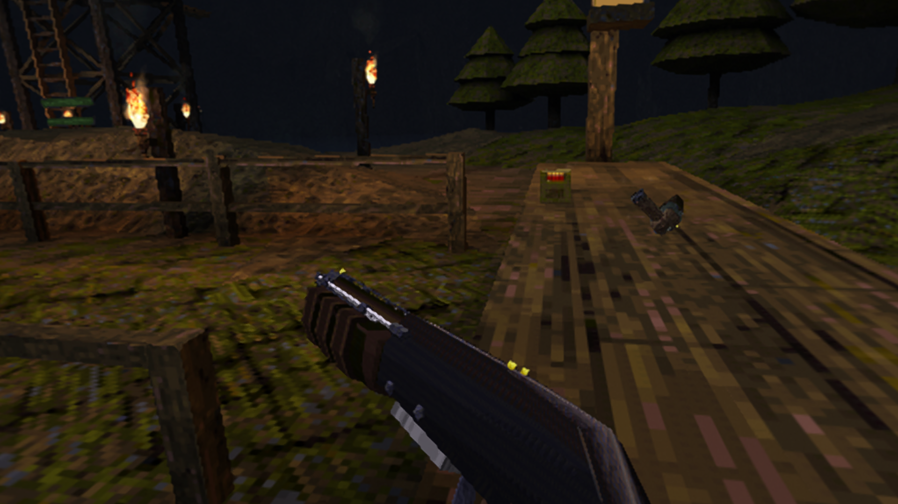

# Steam Frame native port: development and verification

Experimental ARM64/Linux port of **Quake VR: Unleashed 1.0.0** by Vittorio Romeo.
Tested on a physical Steam Frame on 2026-10-12. The wearer confirmed that Quake
entered the game in VR. **Performance still needs improvement in some locations.**
This is a community port, not an official upstream release or a general claim
that every gameplay feature has been tested.



## Working configuration

- Native aarch64 engine, OpenGL/GLX, SteamVR OpenXR 2.18.2.
- Upstream base: `v1.0.0` (`e844de35f4854dc661ad2d697895048d80bb4b40`).
- Steam shortcut marked as VR with `SteamClient.Apps.SetShortcutIsVR(appid, true)`.
- Hidden desktop mirror: `-window -vr-hide-mirror`, `+vr_mirror 0`.
- `SDL_VIDEODRIVER=x11`; runtime JSON `/opt/steamvr/steamxr_linuxarm64.json`.
- Baseline graphics preset 0, render scale 0.45, no MSAA, `-nobindless`.
- Steam dashboard closed before testing the immersive scene.

The combined configuration was verified. The tests do **not** isolate which
Steam integration change alone fixed the earlier flat/theater presentation.
Do not globally disable other games' desktop theater or bypass the playspace.

## What changed in the engine

The Windows release uses an OpenGL WGL graphics binding. This port adds a Linux
`XrGraphicsBindingOpenGLXlibKHR`, using the actual SDL GLX context, drawable,
visual and FBConfig. CMake links the native OpenXR loader, OpenGL GLX and X11.
Windows retains its own binding.

ARM64 builds use vendored SIMDe 0.8.2 for existing SSE/AVX kernels. AO/audio
disable FMA contraction to preserve scalar operation order. Other portability
changes cover the profiling clock, a standard-library include and duplicate
C++ allocation operators. `XR_EXT_user_presence` pauses input/gameplay and
calibration when the headset is unworn. First-run calibration stays pending
until it actually finishes.

Frame controller bindings use the advertised
`/interaction_profiles/valve/frame_controller_valve` profile. The real runtime
selected it for both hands; real pose actions, grip and sticks reached the game.

## Build on Frame

Use the native ARM64 toolchain and SDL2, X11, GL/GLX, OpenXR headers and the
engine's audio dependencies. The tested toolchain was Clang 19.1.7 with C++23.
No root filesystem modification was needed on the tested device.

```sh
cmake -S . -B build-frame -DCMAKE_BUILD_TYPE=Release \
  -DCMAKE_C_COMPILER=clang -DCMAKE_CXX_COMPILER=clang++ \
  -DENABLE_USERDIRS=OFF \
  -DQVR_OPENXR_LIBRARY=/opt/steamvr/bin/linuxarm64/libopenxr_loader.so
cmake --build build-frame -j4
```

The Frame's ordinary OpenXR library search found a dummy static library during
development; explicitly selecting SteamVR's real loader avoided that problem.
Use `ldd build-frame/ironwail` to check runtime dependencies on the target device.

## Separate installation

The port package contains the engine and installation tools. Obtain upstream's
official **v1.0.0 QuakeVR.zip** separately and supply your own Quake `id1` directory
with `PAK0.PAK` and `PAK1.PAK`. No commercial Quake data is distributed.
The tested upstream archive's SHA-256 is
`dab3a2adcd3081512e850b696000b2531e64621878b8565919e230d919619ace`.

```sh
python3 install-frame.py --mod-archive /path/to/QuakeVR.zip \
  --quake-data /path/to/your/Quake/id1
```

The default destination is `~/Games/QuakeVR-Unleashed-native-release/game`.
The installer requires a fresh destination, copies owned PAK files and leaves
the original installation untouched. It validates inputs before installing.
`--check` validates without copying or registering anything. Add `--register`
to add the VR shortcut through the running Steam client when its local DevTools
endpoint is available. Otherwise add `run-native.sh` as a non-Steam game and
mark the shortcut for the VR library in its properties.
The new shortcut is named **Quake VR: Unleashed (Steam Frame)**, so registering
it does not replace the development installation's existing shortcut.

## Preview package audit

The public `v1.0.0-frame.1` assets were downloaded and checked against the
release's `SHA256SUMS.txt`. The 8,296,352-byte Frame kit matched SHA-256
`b8b5d13a2181211187b70c3ba4adcf2ae26d68c0cc1d1c156f0be322e1b163de`; its 19
entries are the native engine, launch/installation/runtime helpers, licenses,
release notes and this guide. It contains no Quake game PAKs, map files or
player saves.

The 181,583,708-byte source archive matched SHA-256
`e5736a76df9c5206cf6b72702b160b325cd2eac70b3a15597a729a2f5679e2f1`. It
contains the port and mod source assets, including project-authored test maps
and `Quake/ironwail.pak` with five small engine menu/config entries. It does
not contain the owner's `id1/PAK0.PAK` or `id1/PAK1.PAK`. Those are supplied
from a separately owned upstream installation by the install command above.

Complete calibration intentionally standing or seated. Putting on the headset
while still settling can initially produce a low automatic height measurement;
the tested body calibration subsequently measured 1.516 m and completed all
seven poses. Use the menu's VR Calibration entry to repeat it if necessary.

## Prove the actual VR state

A VR shortcut checkbox or side-by-side desktop mirror is insufficient evidence.
Use several independent signals:

1. `python3 frame-vr-state.py`: OpenVR's current scene PID, application key and
   compositor scene focus must identify the native engine. This helper starts
   as a **Utility**, never as a Scene, so it does not replace the running game.
2. Start the game with `-qvr-frame-diagnostics`. In `quakevr/qvr_openxr.txt`,
   `FRAME_DIAG` records focus, wearer presence, head pose and view flags.
   `FRAME_HAND` records the selected profiles, actual pose action activity,
   valid hand poses and grip/trigger/stick values delivered to Quake.
3. `FRAME_LAYERS projection=1 stereo_views=2` establishes stereo projection
   submission. A quad is a flat panel; a projection uses the tracked views.
   Verify moving head orientation and actual scene images as well.
4. Capture the **composited headset output**, not the game's desktop mirror:

```sh
ffmpeg -hide_banner -loglevel error -f v4l2 -i /dev/video99 \
  -frames:v 3 -update 1 -y headset.png
/opt/steamvr/bin/linuxarm64/vrcmd --stats
/opt/steamvr/bin/linuxarm64/vrcmd --overlays
```

On this Frame, video99 produced usable images of the VR training area and a
handheld weapon filling the headset view. Passthrough appeared during some
calibration samples; later gameplay samples showed the game without it.
`IVRScreenshots_001` has also produced dark captures. On 2026-10-12 the default
native probe was an active OpenXR scene, but the runtime reported no user
presence and the game held its last projection; its 1920x1080 screenshot was
mostly black with only small scene fragments. A separate scratch-only test
forced fresh stereo rendering and captured the E1M1 scene in both eyes, but the
head action was invalid and there was no motion test. Treat captures without
wearer tracking as rendering diagnostics, not proof of a usable in-headset
view. Standby captures are inconclusive too.

### OpenXR scene-app probe without a wearer (2026-10-12)

This confirms that SteamVR recognizes the native engine as an OpenXR scene app;
it does not replace the wearer checks above. I ran a separate copy of the
release install with a temporary config (`vr_backend openxr`, `vr_enabled 1`,
`map vrfiringrange`, then scripted waits and `quit`), using the normal
`run-native.sh` runtime selection with `QVR_TEST_HIDDEN=1`,
`QVR_TEST_BACKGROUND=1`, and `QVR_NO_ERROR_DIALOG=1`. The normal install and its
configuration were not used or changed.

While it ran, `frame-vr-state.py` reported
`EVRSceneApplicationState_Running`; its scene PID matched
`compositor_scene_focus_pid`, and the application key was
`system.generated.openxr.quake vr.ironwail`. The game log confirmed SteamVR / OpenXR
2.18.2 and `VR: started openxr backend`. The runtime offered 1728x1728 eye
images in `GL_SRGB8_ALPHA8`; `FRAME_LAYERS` then repeatedly reported
`projection=1 stereo_views=2 quad=0 total=1 held=1`. This verifies a stereo
OpenXR projection layer rather than a desktop quad. An initial `READY` sample
reported the startup quad before the map's projection layer was submitted.

The same diagnostics reported `present=0`, `head=0`, and hand pose actions
inactive. The game logged `OpenXR: user presence absent`; SteamVR showed both
Frame controllers disconnected, and HMD pose validity varied during the probe.
With default settings and no wearer, the renderer held its last projection
(`held=1`) rather than submitting fresh tracked views.

In a separate scratch run I set `vr_xr_unfocused 0` and
`vr_xr_unfocused_pause 0` before loading E1M1. The runtime still reported no
presence and the game still had no valid head or hand actions, but
`FRAME_LAYERS` repeatedly reported `projection=1 stereo_views=2 quad=0 held=0`.
Its compositor capture showed the game world in both eyes. This verifies fresh
stereo projection rendering in the OpenXR path; it does not verify head-motion
response, controllers, or playability. These overrides were confined to the
temporary test copy. After the probe exited, SteamVR returned to
`EVRSceneApplicationState_None`. The live state JSON, OpenXR diagnostics, engine
logs and captures are retained privately in
`performance-results/decal-grid-frame-20261012`.

After the Ultra profile update, I also launched its separate `.18` installation
on Frame with `-noconfigwrite` and the same no-wearer render overrides. The
console confirmed `vr_render_scale 0.18` and `vr_particle_mult 0.5`; SteamVR
reported `system.generated.openxr.quake vr.ironwail` as the running scene with
matching compositor focus. OpenXR initialized its two-view projection path and
enabled `XR_VALVE_frame_controller_interaction`. User presence remained absent,
the HMD pose invalid, and both controllers disconnected. This validates that
the installed profile launches through OpenXR; its unpaced ~160 fps log sample
is not headset pacing evidence. `-noconfigwrite` prevented game config writes,
and the process was closed after the check. Logs are in the private
`performance-results/ultra-profile-launch-smoke-frame-20261012` directory.

A second diagnostic launch loaded E1M1 and repeatedly recorded
`FRAME_LAYERS projection=1 stereo_views=2 quad=0 total=1 held=0` after its
startup quad, verifying fresh stereo projection frames from the installed
Ultra binary. `FRAME_HAND` selected
`/interaction_profiles/valve/frame_controller_valve` for both sides, while
`pose_action_active=0` and `valid=0` because the controllers were disconnected.
This demonstrates that SteamVR exposes the Frame profile to the app; it cannot
verify actual controller poses or button delivery without a wearer.

For a repeatable no-wearer check, keep the probe config in a scratch install.
It should set `vr_backend openxr`, enable VR, load a map, wait for several
seconds, and then quit. Do not add `-vrmock`. Start it in one Frame shell:

```sh
cd /path/to/scratch-install
env DISPLAY=:1 SDL_VIDEODRIVER=x11 \
  QVR_TEST_HIDDEN=1 QVR_TEST_BACKGROUND=1 QVR_NO_ERROR_DIALOG=1 \
  ./run-native.sh -noconfigwrite -nomapindex -nosound \
  +exec openxr-probe.cfg > /tmp/openxr-probe.log 2>&1 &
```

While it is running, query state from a second shell:

```sh
python3 ~/Games/QuakeVR-Unleashed-native/frame-vr-state.py
```

A running scene PID and `EVRSceneApplicationState_Running` confirm scene-app
registration. The game log's `user presence absent` explains why input is paused
when nobody wears the headset; disconnected controller entries mean no action
or grip test can be inferred from this probe. To check fresh image submission in
a scratch install, add `vr_xr_unfocused 0` and `vr_xr_unfocused_pause 0` before
`map`, then require `FRAME_LAYERS ... held=0`. These test-only cvars bypass the
normal held-frame/pause behavior and must stay in the scratch config. The probe
config exits by itself; if it does not, stop only the PID launched for this test.

OpenVR device poses alone do not prove delivery to a particular game: compare
them with that game's OpenXR action states. The one-second input log can miss
brief taps. It is diagnostic evidence, not a comprehensive button test.

If the dashboard is still visible over a focused Quake scene, check
`IsDashboardVisible` and close the Steam menu. During development a single
`vrcmd --hidedashboard` changed the verified state from true to false. Do not
use a repeated force-focus loop or change global safety settings.

## Verified results and remaining work

Verified on hardware: native Steam launch, stereo projection, moving head
orientation/position, both hands' valid tracking, grip and stick delivery,
completed body calibration, transition to the VR training hub, shotgun/nailgun
hits and physical axe attacks against the training dummy. The wearer confirmed
that the game entered VR. Native settings and autosaves were written.

Automated isolated engine tests exited 0, loaded the Unleashed VM (CRC 12927),
matched nine AO models against the scalar reference with zero differences,
spawned a shotgun eligible for force-grab and exercised Box3D worlds in e1m1/e1m2.
Those mock tests do not prove physical reload, throwing or climbing.

On 2026-10-12, with no wearer available, the unchanged baseline binary
(`48ce8499…`) ran the `vrslopes` mantle fixture in an isolated Frame scratch
copy using `vr_backend mock`, `vr_mock_fast 2`, and scripted `mantle(1.49)`
hands at the default mantle settings (`vr_climb_mantle_lenient 1`,
`vr_climb_mantle_slope 40`). All eight outcomes matched the fixture (8/8): it
accepted level, up10, up20, up30, down20 and across15, and rejected up45 and
up20slab; both rejections logged `no room to mantle`, matching the slope limit
and ceiling check. This is an
engine/mock integration check; it does not test physical controller poses,
hand feel, or worn OpenXR/compositor pacing. The Frame log is retained at
`performance-results/mock-vr-calltree-20261012/capture/climb-slope-matrix-20261012.log`.

On 2026-10-12, a second native ARM64 mock-input regression pass on Frame ran the
release binary at 0.25 and the render-scale-floor candidate at 0.18, both in a
scratch copy. The reload self-test passed all 67 checks on each. `vr_hull_cachetest`
passed on both, and `vr_physics_mtbench 200 300` produced the same Box3D hash
(`92faaba3aff7d472`) for 1, 2, 3, 4, 6 and 8 workers in both builds. This checks
reload logic and the physics worker implementation; it does not test real hand
poses or in-headset weapon handling.

A randomized synthetic axe-stick-rate sweep did not repeat consistently even
with fixed seeds and the same candidate binary, so I excluded its throw-rate
figures from regression claims. The earlier wearer-confirmed axe hit applies to
the release setup, not the 0.18 preview. Physical axe throws and weapon handling
on the preview remain to be checked.

Calibration samples ran near 72 fps at 778x778 rendered pixels per eye,
upscaled into 1728x1728 XR images. **These are not representative combat
benchmarks.** The wearer reports slow locations; performance is a known issue.
Manual reload, throwing, climbing, representative campaign combat, higher
quality settings and post-calibration restart need further validation.

A historical SteamVR compositor summary at the native process exit on Oct 12
reported 1,829,770 presents, 8 dropped, 2,801 reprojected, and aggregate
application CPU/GPU times of 1.874/3.561 ms. That process ran from 01:11 to
08:14; the same summary includes 6,353 timed-out presents. It spans a long
session and does not isolate active gameplay, so it is not a representative
performance result or a before/after comparison. No `perfcriteria.txt` file was
present in SteamVR's logs during this read-only inspection. A focused wearer
capture remains necessary.

Steam Audio ARM64 is not bundled; the normal Quake audio fallback works.
GL_NV_shading_rate_image hardware foveation is unavailable in this GL path.
Optional campaigns/music depend on the player's owned data.

## Performance work after publication

Record the same map, route, settings and headset refresh rate before and after
each change. Separate startup/calibration, CPU physics and GPU rendering costs.
Use runtime frame submissions/missed periods and engine profiling rather than
long averages polluted by hours of standby. Keep the initial preset and scale
fixed for comparisons. Check input, physics and weapons after changing SIMD,
threading, render targets or update cadence. Publish measured gains and losses;
do not present a lower render scale alone as an engine optimization.

The reproducible `vr_bench` capture writes JSON to
`<gamedir>/profile/bench/frame_<name>.json`. Its `cpu_phase_stats_ms` entries
give per-phase average, p50, p95, p99 and maximum from the same captured frames;
`cpu_phase_ms` remains the phase-average map. Nested timings such as `screen`
and `swap` overlap and must not be added. Compare renderer GPU times with the
runtime's submitted-frame/missed-period counters before attributing a hitch to
the engine. The mock benchmark can find engine CPU/GPU costs on Frame hardware,
but it is not evidence of OpenXR compositor pacing or physical controller use.

On the tested Frame, the released engine was also measured with mock tracking
and real stereo rendering (Turnip/Zink OpenGL, 1728x1728 eye images, 72 Hz
fixed-step `combat_48`, 180 warm-up and 720 measured frames, two opposite-order
runs). At the release baseline scale 0.45, GPU eye time averaged 30.138 ms and
frame median was 31.942 ms. A separate quality/performance preview uses scale
0.25 and zero retro edge softness; on the same binary it measured 12.559 ms GPU
eyes and a 13.888 ms median. The p99 remained 20.765 ms, so it does not establish
sustained 72 fps in campaign play. Scale 0.25 renders 432x432 pixels per eye
before upscaling, and the sharper retro edges change the intended look. The
normal launcher and its 0.45 default are unchanged. This is a measured optional
quality profile, not an engine speedup claim; physical headset validation is
still required before distribution. See [Steam Frame performance measurements](STEAM-FRAME-PERFORMANCE.md)
for the comparison controls and limitations.

A precomputed direct-color palette lookup was also tested at the release's 0.45
render scale. The corrected shader preserved both eye images pixel-for-pixel,
but the Frame measured 30.437 ms GPU-eye time versus 29.972 ms for release and
showed a slower frame median. That candidate was reverted. An initial binding
collision removed scene geometry and produced invalid low timings; it was
identified by the image and render-phase checks and was not accepted.

At render scale 0.25, the Frame measured 13.411 ms GPU-eye time with the shipped
retro edge softness and 12.531 ms with softness off. The former keeps softer
retro boundaries at about a 7% GPU cost; both retain the blur from reduced
render resolution, and both exceeded the 13.89 ms frame p99 budget in combat.
The sharper-edge preview now also sets `vr_particle_mult 0.5`: its two-run
combat mock sweep reduced GPU-eye p99 from 18.72 to 16.48 ms and the VR-particle
CPU phase p99 from 2.25 to 0.73 ms, while average live particles fell from about
5,185 to 1,954. A fixed eye-image pair showed fewer particle effects; entity
and physics counts stayed the same. A follow-up on the actual OpenXR path
submitted fresh stereo images and showed a similar GPU/CPU reduction in a
deterministic particle stress fixture. The setting remains isolated to the
preview profile; wearer tracking, visual acceptance and representative campaign
performance still need validation. See the A-B-B-A results in
[Steam Frame performance measurements](STEAM-FRAME-PERFORMANCE.md).

At the release's 0.45 scale, disabling retro edge softness only for world
materials reduced combat GPU-eye mean by about 2.5% (30.188 to 29.440 ms).
Disabling it for brush materials alone showed no improvement. The world-only
setting changes world-texture edge appearance but preserves softness on models
and weapons; it remains a small optional tradeoff and does not meet the combat
72 Hz budget. The default and performance-preview launcher are unchanged.

An isolated engine candidate lowers the minimum supported render scale from
0.25 to 0.18. At 0.18 with shipped retro edge softness, the Frame measured
9.915 ms mean GPU-eye time; GPU p99 was 13.67 ms, while frame p99 remained
18.49–19.03 ms. This is approximately 311x311 rendered pixels per eye before
upscaling to 1728x1728, with a substantial visible loss of detail. A separate
"Frame Ultra Performance" shortcut and install are prepared for wearer
validation. It has since launched in the actual SteamVR/OpenXR runtime from a
scratch copy. In an A-B-B-A `particles_dense` test at 0.25 on the release binary
and 0.18 on the candidate, with the particle multiplier held at 0.5, mean
GPU-eye time fell from 11.591 to 8.104 ms and GPU-eye p99 from 13.068 to 9.677
ms. The frame p99 stayed over the 13.89 ms 72 Hz budget in both settings.
OpenXR submitted fresh stereo images, but the runtime had no wearer presence and
head/hand actions were invalid. The regular game and .25 preview remain
untouched. At 0.18 each eye renders about 311x311 pixels before upscaling to
1728x1728; this is a severe quality tradeoff, not a claim of stable 72 Hz or a
release-ready improvement. See the detailed OpenXR measurements in
[Steam Frame performance measurements](STEAM-FRAME-PERFORMANCE.md).

The Ultra preview config also sets `vr_particle_mult 0.5`. A separate same-
build OpenXR A-B-B-A at scale 0.18 found 12.9% lower GPU-eye mean, 9.6% lower
GPU-eye p99, and 55.8% lower VR-particle CPU phase than multiplier 1, with
58.2% fewer average live particles and visibly sparser effects. Frame p99 still
exceeded the 13.89 ms 72 Hz budget, and there was no wearer present, so this
remains an optional experimental profile pending headset usability and combat
validation. The standard and .25 preview profiles are unchanged. See the
separate particle-multiplier A-B-B-A results in
[Steam Frame performance measurements](STEAM-FRAME-PERFORMANCE.md).

A follow-up OpenXR A-B-B-A compared particle multipliers 0.5 and 0.75 at scale
0.18. The 0.75 profile kept 48% more live particles but raised GPU-eye mean
5.9%, VR-particle CPU phase 48.5%, and frame p99 about 2.10 ms; both settings
remained above the 72 Hz frame-p99 budget. The Ultra shortcut stays at 0.5 for
its lower render cost, pending a wearer judgement of the visible density tradeoff.

A no-wearer Frame A-B-B-A diagnostic disabled the opaque world/brush depth
prepass in a separate build. At scale 0.18 on the `particles_dense` fixture,
GPU-eye mean rose from 8.19 ms with the existing pass to 17.10 ms without it;
the world/brush phase rose from 2.74 to 8.77 ms despite fewer draw calls.
Fresh two-eye OpenXR layers
were observed in all four runs. This pass is therefore retained. The comparison
does not establish visual equivalence because animated scene captures were not
pixel-identical; see the detailed controls and limitations in
[Steam Frame performance measurements](STEAM-FRAME-PERFORMANCE.md).

The existing pass stays enabled. The baseline GPU p99 was below the 13.89 ms
72 Hz budget while frame p99 exceeded it, so the next no-wearer investigation
will correlate frame-time tails with CPU phases, XR wait/submit timing and
runtime missed-period counters before trying another GPU code change.

The actual Frame hitch profile found high per-frame costs in desktop-window
swap and occasional XR submit, with smaller recurring Box3D/view-setup work.
Skipping the hidden desktop swap removed its CPU cost but moved wait into
`xrEndFrame`, increased GPU-eye mean by 40.6% and worsened frame p99 by 10.8%;
that isolated candidate was rejected. SteamVR treated this no-wearer session as
timed out, so these measurements locate renderer-side costs but do not verify
compositor pacing while worn. The raw comparison and its limitations are in
[Steam Frame performance measurements](STEAM-FRAME-PERFORMANCE.md).

A later, isolated `glFlush`-instead-of-hidden-swap build crashed with SIGSEGV
alongside an Adreno GPU lockup; the kernel reported recovery. The failed candidate was quarantined; a
subsequent unchanged-baseline run again produced 720 frames and fresh stereo
OpenXR layers. Keep the original SDL swap path. The failure and recovery
evidence are recorded in
[Steam Frame performance measurements](STEAM-FRAME-PERFORMANCE.md).

An isolated Clang ThinLTO build was also tested in the Frame's headless mock
mode against the unchanged baseline, with 500 mixed physics props and an
A-B-B-A sequence. Its mean CPU time was about 8% higher across the 899-frame
runs, so this build-only change is rejected. The test does not cover GPU
rendering or worn OpenXR pacing; details are in
[Steam Frame performance measurements](STEAM-FRAME-PERFORMANCE.md).

### Wearer regression checklist for the particle preview

The performance-preview shortcut is a separate installation and starts at
render scale 0.25 with `vr_particle_mult 0.5`. Before comparing density, verify
those values in the in-game console, then keep the same map, route, preset and
headset refresh rate while comparing `vr_particle_mult 1` and `0.5`. Restore
0.5 before leaving the preview. The regular native release and QuakeQuest are
not part of this comparison.

On each value, check that SteamVR's active scene and compositor focus identify
the native engine; `qvr_openxr.txt` reports stereo projection and valid head and
both-hand pose actions; and the captured headset view is stereoscopic rather
than a desktop panel. Turn and translate the head, move both controllers, and
confirm the hands follow them rather than acting as a mouse pointer. In the
training range, fire the shotgun and nailgun, reload manually, hit the dummy
with the physical axe, then throw and catch a weapon and climb a rung. The
particle setting should change effect density only; report any tracking,
interaction, rendering or gameplay regression separately.

Capture the runtime's performance-criteria counters for both runs and note
missed periods alongside the engine's timing log. The earlier 720-frame mock
benchmark is useful for CPU/GPU attribution but does not replace this in-headset
comparison. Do not describe the preview as meeting 72 Hz unless the runtime
data from representative play supports that claim.

### Headset-unworn CPU profile (2026-10-12)

When no wearer is available, `vr_backend mock` and a scripted `vr_mock_play`
take can exercise a repeatable CPU fixture on the Frame itself. This checks
engine scopes, not real OpenXR tracking, controller delivery, compositor pacing
or image acceptance. Use `vr_mock_fast 1` to keep both eyes rendering; `2`
skips screen drawing and is unsuitable for rendering profiles. The diagnostic
run used the baseline binary (`48ce8499…`), `vrfiringrange`, the `melee_punch_8`
fixture (nine grunts, scripted alternating punches), 360 frames, 384 mock pixels
per eye, and the installed profile settings (preset 0, render scale 0.45,
FSAA 0, mirror off, dynamic/map shadows off). The JSON recorded these settings,
which is a required validity check after every profile run.

Two same-baseline runs started profiling immediately before the measured
window, after map setup and warm-up. Both began with nine monsters and 142
Box3D bodies. Frame means were 6.40/6.25 ms (p99 15.43/15.93 ms) and GPU-eye
means were 2.73/2.73 ms; neither run had a frame over 33 ms. The call trees
agreed: `SV_Physics` averaged 0.66/0.62 ms, Box3D 0.25/0.24 ms, the Box3D step
0.096/0.093 ms and Box3D sync 0.124/0.118 ms. Sync maxima were 0.697/0.718 ms.
`view entities` averaged 0.41/0.38 ms, of which body collision was 0.021/0.020
ms. The earlier 18.98 ms Box3D-sync maximum came from profiling that started
during setup, outside the measured window; it did not recur. No source or
thread-count change was justified by these repeats. Earlier high-default
profiles (scale 1, FSAA 4) are excluded from launcher-performance results.

The 384-pixel mock result is only a CPU-scope diagnostic. It cannot predict
the 1728-pixel-per-eye headset workload or confirm 72 Hz in worn combat. Wait
for a wearer and representative gameplay before pursuing renderer or physics
changes unless repeated profiling establishes a specific, material CPU scope.

### OpenXR body-collision A-B-B-A and wearer-profile readiness (2026-10-12)

The physical-Frame OpenXR `combat_48` A-B-B-A at scale 0.18 collected 720
frames per run with stereo projection layers and eye-GPU timing. Runs 1–3 had
matching average counts (48.6 monsters, 194.2 Box3D bodies and 16.7 contacts)
and frame means of 13.955 ms with collision on, 13.912/13.915 ms with it off;
GPU-eye means were 6.693, 6.734 and 6.782 ms. This gives no material evidence
that the cvar is the frame-time bottleneck. Run 4, with collision on, evolved
to a substantially heavier scene (259.7 bodies, 98.4 contacts, 8,124 VR
particles on average) and is not a valid matched A repeat. Do not use it to
claim either a regression or speedup. Full limitations and per-run values are
in [Steam Frame performance measurements](STEAM-FRAME-PERFORMANCE.md); raw
artifacts remain on the Frame in
`performance-results/frame-tail-hitches-20261012/body-collision-abba-20261012`.

A later interactive profiling launch used the installed native binary with
`vr_profile 1`, GPU timing disabled and a five-second report interval. The
runtime identified the process as the active SteamVR OpenXR scene app and the
game created two-eye swapchains, but the HMD reported `present=0`, the
dashboard was visible, and neither controller was connected. The engine held
the submitted stereo layer (`held=1`); only startup/menu CPU profiles were
collected. This is not wearer gameplay or performance evidence. See
`/tmp/qvr-wearer-profile-20261012.log` and the installed game's
`quakevr/profile/profile_vrstart_2026-10-12_17-54-37.csv` on the Frame. Repeat
only when the HMD presence sensor and both controller pose actions are live.

### GPU hang after a kill (the training dummy), and the Turnip autotune switch (2026-10-15)

Killing a monster (first seen with the axe on the firing range's dummy) could freeze the headset and reset the GPU:
`gpu fault ring 2 ... status 00CE1185` with UCHE read-translation faults at 64-byte strides inside unmapped holes next to
~4 MB buffers, or a BR_SP/CP write fault. It reproduces without a wearer: `Misc/frame/run-dummy-kill-repro.py` (a scratch
copy of the game, the OpenXR backend with no wearer, `vr_dummy_test 3` six times on `vrfiringrange`) and
`Misc/frame/killrepro-matrix.py` (randomised A/B rounds; a hang leaves a devcoredump if
`install-devcore-watch-service.sh` was run). The crash is probabilistic: the unchanged build passed about half of the
real-path runs (`rel_base` 2/4, `h2_async` 1/4), and `ZINK_DEBUG=flushsync` made it near certain, so A/Bs use that.

What the runs established (HEAD source plus only test hooks):

- **Needed:** the world shader's decal loop (`DecalsAt` in `vr_glsl.h`) actually executing its buffer and atlas loads. With
  `vr_decals 0` or `vr_decals_world 0` it never crashed; with the loads compiled in but never reached it passed; making
  the shader read but not apply them still crashed.
- **Not the cause (each tested):** SSBOs as such (the same data through buffer textures and `texelFetch` still crashed);
  buffer replacement or orphaning (updating in place still crashed); the OpenXR layer or FDM; `vr_dummy_gore`, wounds or
  the mock backend; private-memory spill in the shader (the disassembly has none: about 10,000 instructions, 6 loops,
  32 registers); a buffer missing from the submit's BO list (Zink submits its whole global list, 300+ BOs).
- **Lowered the odds in the headless runs (it did not hold on the headset, see the update below):** forcing sysmem rendering (`TU_DEBUG=sysmem`) or the autotuner's `TU_AUTOTUNE_ALGO=prefer_sysmem`, or
  `TU_DEBUG=noubwc`. Forced gmem (`TU_DEBUG=gmem`) and `ZINK_DESCRIPTORS=lazy` looked fixed under flushsync but still
  crashed on the real async path (gmem 1/4, lazy 2/4). Not fixed: `nolrz`, `nobin`, `flushall`, `nodescprefetch`,
  `nopreamble`, `nouboopt`, and the other autotune algorithms.

**Update, same day: `prefer_sysmem` did not hold on the headset.** A wearer's run with the launcher's `prefer_sysmem` crashed on
the first kill (a double-barrel shotgun, 14 pellets, 14:02; the game log ends on that kill). The devcoredump's faulting submit
(fence 43336; the in-flight IB is `CP_IB1_BASE` at register 0xb16 on a7xx, not the ring's rptr, which already points at the next
submit) has its world pass binned and rendered in GMEM, 3 bins. So the autotuner did not pick sysmem for that pass although
`TU_AUTOTUNE_ALGO=prefer_sysmem` was set (the launcher was edited at 12:01, the game started at 14:01). Turnip's autotune
overrides the algorithm for some passes (the library logs `selecting=GMEM reason=fdm` and `reason=preempt_latency_risk`), and
Valve's FDM injection layer adds foveation to the render passes Zink makes, so a worn headset can force GMEM where the
headless runs (no wearer) get sysmem. Which reason applied was not captured (`MESA_LOG_LEVEL=debug` printed no autotune lines).

The fault: `BR_SP` read, translation fault at iova 0xec0 (other dumps 0 and 0xf00, sometimes UCHE). In both dumps it is
frozen (`RBBM_STATUS3` bit 24, SMMU stalled on fault) right after a 1x1x1 `gather_indirect` compute dispatch that follows the
GMEM world pass; the faulting instruction is not identified. The decal data are fine in that submit: SSBO bindings 3 and 4 and
the atlas have valid descriptors with the engine's exact sizes (Decals 4560 B = 57 records, DecalGrid 38468 B), so an earlier
note here that the decal SSBO base was null is not supported by the dump. Never binding SSBOs 3 and 4 at all (`h2_dnobind`)
still reproduces the signature 3/3.

Checked since, all without result:

- The engine's and Mesa's own state is right. A test build (`QVR_DECAL_BINDTEST`, test hook only) asked Mesa for the buffer,
  start and size of SSBO bindings 3 and 4 right before every world draw: over 100,000 checks, even in runs that then
  crashed, there was no mismatch. Unbinding and rebinding both before each draw still crashed (async 3/3, flushsync 1/3).
- Mesa's threads are not it: with `GALLIUM_THREAD=0`, with `mesa_glthread=false` and with both, on the release binary's
  async path, 4 rounds each: `rel_base` 4/4 crashed, `GALLIUM_THREAD=0` 4/4, both off 4/4, glthread off 2/4.
- The headless runs did not have the Steam client's environment: a shortcut-launched game inherits
  `MESA_GL_VERSION_OVERRIDE=4.3` and `MESA_GLSL_VERSION_OVERRIDE=430` (the game log says GL 4.3; the 292 headless runs said
  4.6). With both set (`ov_*` variants, 4 rounds, 6 kills): no switch 3/4 crashed, `prefer_sysmem` 0/4, `vr_decals_world 0`
  0/4. The override is not what separates the headset from the rig.
- Forcing GMEM reproduces what the headset did. The wearer's faulting submit had the world pass in GMEM although
  `prefer_sysmem` was set (autotune picks GMEM for `fdm` or `preempt_latency_risk`, which a headless run need not hit). Matrix `gm1`
  (Steam environment, `TU_DEBUG=gmem` unless noted, 4 rounds, 6 kills): no other switch 2/4 hung, `prefer_sysmem` on top of the
  forced GMEM 3/4 hung (the headset's outcome), `vr_decals_world 0` 0/4 hung (one round logged ten non-fatal `BR_SP` WRITE faults
  at iova 0x100/0x300 from the Zink flush thread, the game ran on), `vr_decals_world 0` under flushsync as well 0/4, and
  `TU_DEBUG=sysmem` (no forced GMEM) 0/4. So `vr_decals_world 0` removes the hang but not necessarily every fault; the hard
  `TU_DEBUG=sysmem` override is clean in 8/8 headless runs of that kind so far. (A `source=CP` WRITE fault at iova
  0x1100b00xx at the very end of a run is process exit, harmless; the matrix scripts count it as a fault line.)

**What works:** `vr_decals_world 0`. The decals are then drawn as meshes and the world shader never runs `DecalsAt`.
12/12 clean on the release binary (6 under flushsync, 6 async), 4/4 more with the Steam environment above, plus 3/3 earlier
under flushsync, against a flushsync baseline that crashes about 93% (13/14). It costs the shader-based decal look on the world, not stability. Not yet
confirmed by a wearer, and not yet in the launchers.

Headless real-path results before the headset run (clean runs of 4, 6 kills each): `prefer_sysmem` 4/4 on the HEAD test
build and 4/4 on the release binary, `TU_DEBUG=sysmem` 4/4, `TU_DEBUG=noubwc` 4/4, gmem 1/4, lazy 2/4, no switch 1/4 and 2/4.

Cost of `prefer_sysmem`, on the mock-stereo `combat_48` benchmark (720 frames, 2 rounds, `run-perf-modes.py`): no switch
30.3 ms mean frame (world pass 22.4 ms GPU), `prefer_sysmem` 29.0 ms (18.5 ms), `TU_DEBUG=sysmem` 29.2 ms, `noubwc`
33.5 ms, gmem 35.8 ms, lazy 31.5 ms. The launchers keep `TU_AUTOTUNE_ALGO="${TU_AUTOTUNE_ALGO:-prefer_sysmem}"` for the
frame time, not as the hang fix.

**Replaying a kill on the real runtime.** `vr_motion_play <take> xr [kill]` (docs/vr-port/MOTIONS.md) plays a Motion Recorder take
through the OpenXR backend: the take's head, hands and buttons drive the game, the runtime renders, paces and composites as for a
wearer (the eyes are the take's head with the runtime's own offsets; `kill` lets the dummy die of the take's blows, as live).
`run-dummy-kill-repro.py --scenario replay --take <file> --map vrfiringrange --repeat N --play-arg kill --backend openxr
--exe ironwail-replay` runs it on the Frame, one play per kill. `Misc/quakevr/motion_synth.py gun_kill --rate 72
--name gun_kill_ssg` writes a take of one double-barrel shot at the dummy; replayed headless it prints the wearer's line
(`84 damage - weapon fire: Double-barrelled Shotgun, 14 pellets, 14 head (x1.50) - health 0/30 - killed`) four times in a
row (`replay-gun2`). The axe is a throw: that take wants recording in the headset (Motion Recorder). A recording of a kill can
only be made where the game survives the kill (the take is written when it stops), hence a workaround active in the launcher
first.

Not yet done: a wearer's run with `vr_decals_world 0` or `TU_DEBUG=sysmem` (kill several monsters, with the shotgun), the
replay matrix (does the replay hang the GPU as often as `vr_dummy_test 3`?), and a minimal report to Mesa/Turnip. The first-run baseline is probabilistic, so a single clean headset run proves little; the matrix
(`killrepro-matrix.py <name> <rounds> rel_base,rel_dw0 6`) is the check. A hang also takes down SteamVR and the gamescope
session, which usually restarts by itself (it did at 14:02). Once (after many hangs in one night's runs) it did not:
gamescope aborted on `Assertion '!modifiers.empty()'` in `CVulkanTexture::BInit` on every start while an orphaned
vrserver/vrcompositor from the previous session was still running; rebooting the headset cleared it.

## Credits and source

- Original mod and engine source: [Vittorio Romeo's Quake VR](https://github.com/vittorioromeo/quakevr).
- Native GLX reference: [SteamFrameRaylibQuickstart](https://github.com/Dinsmoor/SteamFrameRaylibQuickstart).
- [SIMDe 0.8.2](https://github.com/simd-everywhere/simde/tree/v0.8.2), MIT license preserved.
- Steam shortcut helper: [saphid/chromium-webxr-steam-frame](https://github.com/saphid/chromium-webxr-steam-frame), BSD-3-Clause license preserved.
- Diagnostic interfaces: [Valve's OpenVR C API](https://github.com/ValveSoftware/openvr/blob/master/headers/openvr_capi.h).

Engine distribution follows the repository's GPLv2 license and preserves third
party notices. Maintainers are welcome to integrate or take over the port in
the upstream repository; performance work remains experimental.
